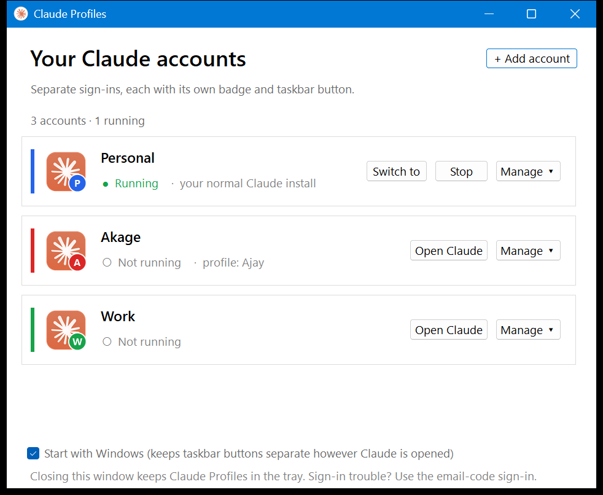
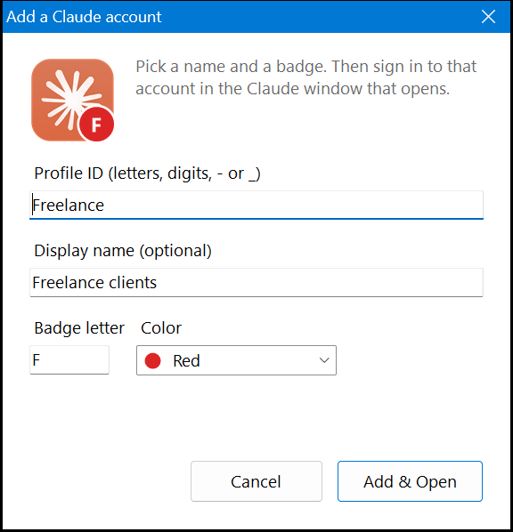

# Claude Desktop Profiles (Windows)

Run several Claude Desktop accounts side by side on Windows: personal, work, a second personal, and so on.
Each account gets its own sign-in, its own badge icon, and its **own taskbar button** you can pin.

Your existing Claude Desktop install and login are never touched. They stay your **Main** account.



## Features

- **Separate sign-ins.** Every account runs as a separate Claude Desktop profile, with its own login, settings and sessions.
- **Badge icons, like Chrome profiles.** The Claude logo with a coloured letter, plus an optional display name.
- **Own taskbar button per account.** Open accounts don't pile up under a single Claude button. Pin each one.
- **Tray icon.** Left-click opens the window. Right-click lists every account (• means running) for one-click switching, plus **Stop**.
- **Stop.** Fully quits an account. Claude's own close button only hides it to the tray.
- **Manage ▾** for each account: edit the name and badge, create Desktop and Start Menu shortcuts, open the data folder, or delete the profile. Deleting asks first and never touches Main.
- **Start with Windows** (optional). While the app runs, every account keeps its own taskbar button, however Claude was opened.
- **Main is editable too.** Give it a display name and badge. With a badge it gets its own taskbar button. Use *Manage → Create shortcuts* and pin that instead of the regular Claude pin.



## Install

Requirements: Windows 10/11 and Claude Desktop (Microsoft Store or the classic installer). No admin rights are needed, and nothing else needs installing. The app is built with the C# compiler that ships with Windows.

```powershell
git clone https://github.com/Akage1234/claude-desktop-profiles
cd claude-desktop-profiles
.\build.cmd
.\ClaudeProfiles.exe
```

Then click **+ Add account**. Pick an ID, a display name, a badge letter and a colour, then click **Add & Open**, and sign in to that account in the Claude window that opens. Shortcuts are created on the Desktop and in the Start Menu. To pin one, right-click it → *Show more options* → **Pin to taskbar**.

Keep the folder where it is after setup, because the shortcuts point to `ClaudeProfiles.exe` inside it.

If Windows SmartScreen warns about the `.exe`, that's because you built it yourself and it isn't code-signed. Choose *More info → Run anyway*.

## How it works

- **Separate sign-ins:** Claude Desktop is an Electron app. Starting it with `--user-data-dir=<folder>` gives it a completely separate profile. Each account's folder is `%LOCALAPPDATA%\Claude-<ID>`.
- **Separate taskbar buttons:** Windows groups taskbar buttons by *AppUserModelID*. The app tags each account's windows with their own ID (`SHGetPropertyStoreForWindow`), and the account's shortcut carries the same ID, so a pin and its windows share one button.
- **Icons:** badges and the app icon are drawn from the logo in your local Claude install, so no Anthropic artwork is stored in this repo.
- **Settings:** the account list and generated icons live in `%LOCALAPPDATA%\ClaudeProfilesApp`.

## Notes and limits

- **Sign-in links:** the browser sign-in returns to the app through a `claude://` link. If the login lands in the wrong window, use the email-code sign-in instead.
- **Store installs** silently redirect the data folders to `%LOCALAPPDATA%\Packages\Claude_*\LocalCache\Local\Claude-<ID>`. *Manage → Open data folder* takes you there.
- The startup task, background service and Cowork VM belong to the Claude install, so all accounts share them.
- Without **Start with Windows**, an account opened by something other than its shortcut (for example a link) shares the Main button until Claude Profiles is running.

## Without the app: PowerShell only

If you'd rather not build an `.exe`, `new-profile.ps1` creates an account's badge icon and shortcuts. Those shortcuts run `launch.ps1`, which starts Claude and tags its windows while it runs.

```powershell
.\new-profile.ps1 -Name Work -Letter W -Color "#16A34A"
```

| Parameter | Default | |
|---|---|---|
| `-Name` | (required) | Letters, digits, `-` and `_`. The data folder is `%LOCALAPPDATA%\Claude-<Name>` |
| `-Letter` | First letter of `-Name` | Text in the badge |
| `-Color` | `#2563EB` | Badge colour |
| `-Force` | off | Overwrite existing shortcuts |

If PowerShell blocks scripts: `powershell -ExecutionPolicy Bypass -File .\new-profile.ps1 -Name Work`.
Profiles made this way also show up in the app automatically.

## Files

| File | |
|---|---|
| `ClaudeProfiles.cs` | The tray app |
| `AppId.cs` | Win32 interop that sets AppUserModelIDs on windows and shortcuts |
| `build.cmd` | Builds `ClaudeProfiles.exe` |
| `make-icon.ps1` | Generates the app icon from the local Claude install (run by `build.cmd`) |
| `new-profile.ps1`, `launch.ps1`, `common.ps1` | The PowerShell-only version |

Inspired by [Leonxlnx/claude-desktop-multi-account](https://github.com/Leonxlnx/claude-desktop-multi-account). Not affiliated with Anthropic.

## License

MIT
